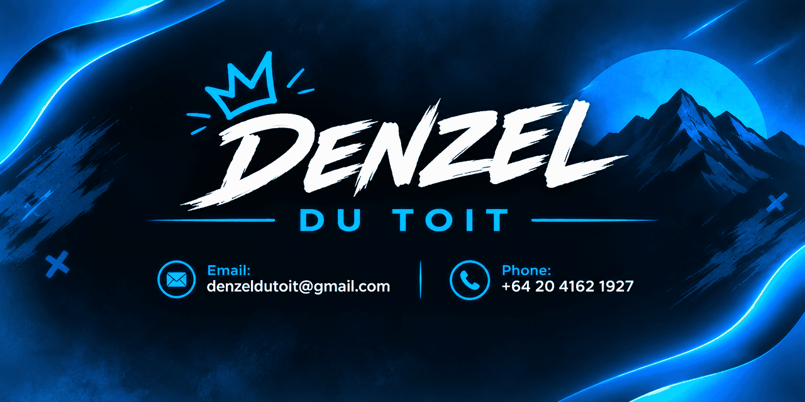

# Hey, I'm Denzel du Toit 👋

### Software Engineering & Web Development

I enjoy building software, systems, and web applications—focusing on clean UI development, database design, and solid system architecture. Always curious about technology, I'm continuously expanding my technical stack and tackling complex problem-solving.

---

## ⚡ What I'm Into

- 💻 Building functional, user-centric software and frontend web experiences
- 🧩 Solving complex logic problems and exploring system architectures
- 🗄️ Database management, graph databases, and application planning
- 🌱 Continuous learning across software development and modern tech tools

---

## 🚀 Featured Projects

- 📺 **[StreamHUB](https://github.com/MrNoBody0402/StreamHUB)** — A web platform project focused on media streaming and dynamic content loading.
- 🤖 **[discord-bot-in-VC-24-7](https://github.com/MrNoBody0402/discord-bot-in-VC-24-7)** — A 24/7 active voice channel Discord bot solution.

---

## 🛠️ Tech Stack & Tools

**Languages & Web**  

---

## 📫 Connect With Me

* **Email:** [denzeldutoit@gmail.com](mailto:denzeldutoit@gmail.com)
* **Phone:** +64 20 4162 1927

---

*Always building, solving, and learning.* 🚀
